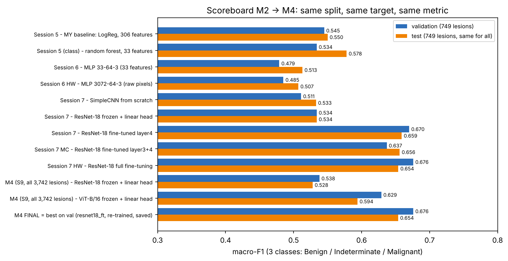
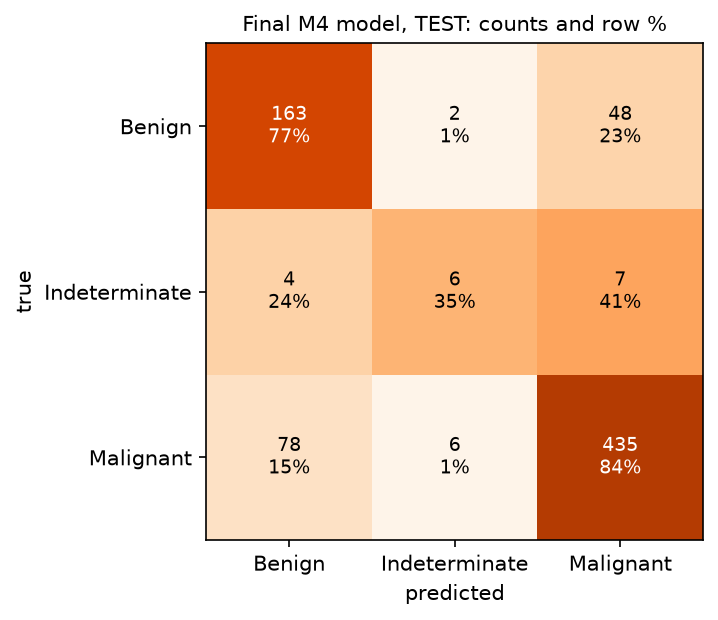
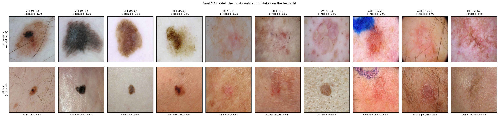
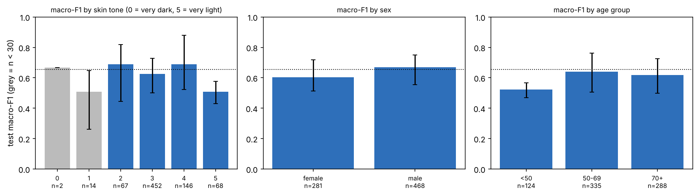
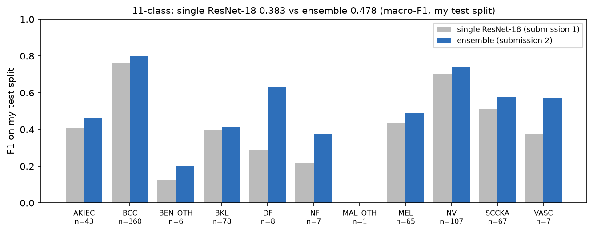
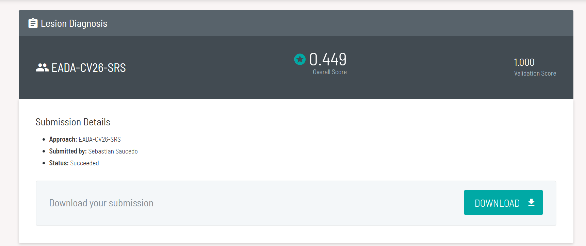

**Repository:** <https://github.com/sebarios02/Milk10k-project> · **Leaderboard approach name:** `EADA-CV26-SRS`

**Target used for the analysis (M2–M4): `diagnosis_1`, 3 classes (Benign / Indeterminate / Malignant), Path A.** The leaderboard submissions (M5) use the same architecture re-trained once with 11 outputs, and then an ensemble that adds the clinical image and the metadata.

| In one table | Value |
|----------------------------|--------------------------------------------|
| Final model (M4) | ResNet-18, ImageNet-pretrained, **all layers fine-tuned**, dermoscopic image only |
| Validation macro-F1 (749 lesions) | **0.676** |
| Test macro-F1 (749 lesions, opened once) | **0.654** [95 % CI 0.570–0.727] · accuracy 0.806 · malignant recall 0.838 |
| Fair backbone comparison (both frozen, same head) | ViT-B/16 0.629 vs ResNet-18 0.538 on validation, Δ +0.090 [+0.047, +0.132] |
| 11-class ResNet-18, my test split | 0.383 [0.327, 0.432] (validation 0.390) |
| 11-class ensemble (both views + metadata), my test split | 0.478 [0.408, 0.531] |
| Official MILK10k leaderboard (479 blind lesions) | submission 1 (ResNet-18): 0.420 · **submission 2 (ensemble): 0.449** |

# 1. Problem and data

**Clinical question.** Given a photograph of a skin lesion that a clinician found suspicious, which lesions should be seen or biopsied first? The model is a *triage second reader*: the dangerous error is calling a malignant lesion benign.

**Data.** MILK10k (MILK study team, ISIC Archive, CC-BY-NC): **5,240 lesions, 10,480 JPEG images**, one dermoscopic and one clinical close-up per lesion, collected retrospectively at 5 centres. Labels: `diagnosis_1` (3 classes) and an 11-class diagnosis (`training_gt.csv`). For M2–M4 and the first submission the model input is **the dermoscopic image only** (the brief's default input) and the clinical view is used only to look at errors; the second submission (Section 6.2) also uses the clinical view and the metadata.

**Class imbalance.** Lesion-level shares are Malignant 69.4 %, Benign 28.3 %, Indeterminate 2.3 % (all Indeterminate lesions are actinic keratoses, AKIEC). On the training split Malignant : Indeterminate = **29.5 : 1**; for 11 classes BCC : MAL_OTH = **257 : 1** (1,802 vs 7 lesions). Consequences used throughout: class-weighted cross-entropy (`N / (K·n_c)`), and **macro-F1** as the only comparison metric (a model that always says "Malignant" already has 69 % accuracy, but a macro-F1 of 0.27).

**Why a score here is not a score in the clinic.** 96 % of MILK10k lesions were confirmed by histopathology, i.e. they had already been selected for biopsy. The benign lesions are the suspicious-looking ones, and malignancy is far more frequent than in a screening population. Predictive values measured here do not transfer to a normal clinic (Milestone 1 report, Section 5).

**Leakage rules (fixed in M1, never changed).** `diagnosis_2–4`, `diagnosis_confirm_type`, `concomitant_biopsy` and `melanocytic` encode the label and are never inputs; `image_manipulation` is a potential shortcut and is not an input. The deep models use pixels only.

# 2. Splits

* **Lesion-level split** with `StratifiedGroupKFold` (groups = `lesion_id`, seed 42), stratified on the 11 classes refined by `diagnosis_1`: **3,742 / 749 / 749 lesions** (train / validation / test). Both images of a lesion are always in the same split. Zero lesion overlap is asserted in code (`milk10k_pipeline/splits.py`, `tests/test_splits.py`, and again in `deep.load_frames()` before every M4/M5 run). The largest deviation of any 11-class proportion from the global one is 0.09 percentage points.
* **Why no leakage.** Splitting images instead of lesions would put one view of a lesion in train and its sibling view in test; in M1 a "sibling oracle" reached 0.85 balanced accuracy that way. Normalisation statistics, class weights and thresholds are computed on train (or validation) only.
* **One protocol for every model.** Hyper-parameters, epochs and the choice of model are decided on **validation**. The **same 749 test lesions** score every model in the scoreboard, and the final model's test number is computed once, after the choice.
* **Remaining risk:** there is no patient id, so two lesions of the same patient can fall in different splits.

# 3. Models and scoreboard (M2 → M4)

All rows: same split, same target (3 classes), same metric (macro-F1), dermoscopic image (M2 also uses age, sex and site as features).

| Milestone | Model | Trainable weights | Val macro-F1 | Test macro-F1 |
|---------|---------------------------------------------|----------:|--------:|--------:|
| M2 | Logistic regression on 306 hand-crafted colour / texture / shape features + metadata (my baseline) | 921 | 0.545 | 0.550 |
| M2 | Random forest, 33 features (class version) | – | 0.534 | 0.578 |
| M3 | MLP 33-64-3 on the 33 features | 2.4 k | 0.479 | 0.513 |
| M3 | MLP 3072-64-3 on raw 32×32 pixels | 197 k | 0.485 | 0.507 |
| M3 | Small CNN from scratch (2 conv blocks) | 306 k | 0.511 | 0.533 |
| M3 | ResNet-18 frozen + linear head (S7) | 1.5 k | 0.534 | 0.534 |
| M3 | ResNet-18 fine-tuned, layer4 + fc | 8.4 M | 0.670 | 0.659 |
| M3 | ResNet-18 fine-tuned, layer3 + layer4 + fc | 10.5 M | 0.637 | 0.656 |
| M3 | ResNet-18 fully fine-tuned | 11.2 M | 0.676 | 0.654 |
| **M4** | **ResNet-18 frozen + linear head, all 3,742 lesions (S9)** | 1.5 k | 0.538 | 0.528 |
| **M4** | **ViT-B/16 frozen + linear head, all 3,742 lesions (S9)** | 2.3 k | **0.629** | 0.594 |
| **M4 final** | **ResNet-18 fully fine-tuned, re-trained and saved (`model_m4.pt`)** | 11.2 M | **0.676** | **0.654** |

{width=95%}

**What the table says.** Hand-crafted features (M2) and networks that only see the pixels without pre-training (M3 MLPs, small CNN) all land around 0.50–0.58. The jump comes from **ImageNet pre-training plus fine-tuning** (0.67 on validation). Frozen backbones stay at the level of the hand-crafted baseline for ResNet-18, but not for the ViT.

**ViT vs ResNet, fairly (Session 9, slide 25).** Same 3,742 training lesions, same frozen setup, same linear head (Adam 1e-3, 25 epochs, class weights), same metric; only the backbone changes. The ViT-B/16 class token transfers much better than ResNet-18's pooled features: **+0.090 validation macro-F1, paired bootstrap 95 % CI [+0.047, +0.132], P(ViT better) = 1.00**, so the gap is not noise. It also holds on test (0.594 vs 0.528). With the full training set the frozen ViT improved from 0.606 (1,000 lesions in class) to 0.629, while ResNet-18 barely moved (0.530 → 0.538). The cost: 7.7× more backbone weights (85.8 M vs 11.2 M) and **9× longer feature extraction on my CPU** (1,106 s vs 121 s for the 3,742 training images).

# 4. Best model: what I chose and why

**Choice rule, fixed before looking at test:** highest validation macro-F1 among all deep models (Sessions 7–9). The winner is the **fully fine-tuned ResNet-18** (val 0.676), ahead of the layer4-only ResNet (0.670) and the frozen ViT (0.629).

* **Recipe** (Session 7): ImageNet weights, new `fc` = `nn.Linear(512, 3)`, all 11.2 M weights trainable, Adam lr 1e-4, batch 64, 6 epochs, class-weighted cross-entropy, random horizontal/vertical flips, input 224×224 with ImageNet normalisation, best epoch kept by validation macro-F1 (epoch 5).
* **Reproducibility.** Session 7 did not save weights, so `scripts/13_m4_best_model.py` re-trains the winner with the same seed and order. It reproduced the Session 7 run exactly (identical validation macro-F1 at all 6 epochs, same test confusion matrix) and is saved as `checkpoints/model_m4.pt`.
* **Test, once:** macro-F1 **0.654 [0.570, 0.727]**, accuracy 0.806, malignant recall 0.838 (435 / 519).
* **Honest caveats on the choice.** (1) The winner and the runner-up (layer4-only, 25 % fewer trainable weights and 2.5× faster per epoch) are **within noise** on validation: paired bootstrap Δ [−0.044, +0.063], P(full better) = 0.61. Following the rule, I keep the full fine-tuning, but the cheaper model would be an equally defensible choice. (2) The comparison between the fine-tuned ResNet and the frozen ViT is not like-for-like: the ViT was never fine-tuned. Fine-tuning a ViT-B/16 (86 M weights) was not feasible on my CPU: one forward pass over the training images already takes 18 minutes, so training (forward + backward) would take roughly an hour per epoch. Given the frozen gap (+0.09), a fine-tuned ViT is the most promising next step.

# 5. Error analysis and fairness

## 5.1 Where the errors are

{width=48%}

145 of 749 test lesions are misclassified. Rows = truth: **78 malignant lesions are called Benign (15 %)**, 48 benign lesions are called Malignant (23 %), and only 6 of 17 Indeterminate lesions are recognised.

| Diagnosis (11-class) | n | → Benign | → Indet. | → Malignant | correct |
|------------------------|-----:|---------:|---------:|-----------:|--------:|
| BCC (malignant) | 360 | 8.1 % | 0.8 % | 91.1 % | 91 % |
| NV (benign) | 107 | 92.5 % | 0 % | 7.5 % | 93 % |
| BKL (benign) | 78 | 59.0 % | 2.6 % | 38.5 % | 59 % |
| SCCKA (malignant) | 67 | 11.9 % | 1.5 % | 86.6 % | 87 % |
| **MEL (malignant)** | 65 | **58.5 %** | 1.5 % | 40.0 % | **40 %** |
| AKIEC (Indet. / Malig.) | 43 | 14.0 % | 16.3 % | 69.8 % | 67 % |
| DF, INF, VASC, BEN_OTH (benign) | 28 | 64 % | 0 % | 36 % | 64 % |
| MAL_OTH (malignant) | 1 | 100 % | 0 % | 0 % | 0 % |

**The single most important finding: 58.5 % of melanomas are called Benign.** Melanoma accounts for 38 of the 78 missed malignant lesions although it is only 9 % of the test set. The model is very good at BCC (the class that is 48 % of the training data) and at typical nevi, and poor exactly where the clinical stakes are highest.

## 5.2 What the misclassified images have in common

{width=100%}

Looking at the most confident mistakes:

* **Missed melanomas look like nevi.** The four melanomas called "Benign" with p ≥ 0.99 are well-circumscribed, brown, pigmented lesions on a clean background, without ulceration or vessels. The model seems to have learned "pigmented and orderly = nevus", which is precisely the hard case dermatologists use dermoscopic criteria (atypical network, regression, asymmetry of colours) for.
* **Benign lesions called malignant are pink and non-pigmented.** The BKL and NV lesions called "Malignant" with p ≥ 0.99 are pinkish, erythematous, with visible vessels and few pigment structures — the typical look of BCC, the majority class. This is the class-prior bias of a dataset where "pink = BCC" is right most of the time.
* **Artefacts.** One Indeterminate AKIEC has a **blue ink marking** in the dermoscopic image (MONET's "skin markings, pen ink" concept exists for this reason). Pen marks are known shortcuts for "this lesion was going to be excised"; with one example I cannot conclude it drove the error, but it is a risk.
* **Overconfidence.** The worst errors have predicted probabilities of 0.99–1.00: the softmax outputs are not calibrated, so a high probability is not a guarantee.
* **Body site.** 42 % of errors are on the head/neck vs 25 % of correct predictions (sun-damaged skin, where AKIEC, BCC and BKL overlap visually).
* **Lesion mask (Session 8 / M2 Otsu features).** Errors have slightly larger masks (median area fraction 0.23 vs 0.20) and similar asymmetry; missed melanomas are, if anything, *less* asymmetric (0.17 vs 0.20). Shape from a rough mask does not explain the errors; colour and texture patterns do.

## 5.3 Fairness check (test split)

Skin tone uses the MILK10k `skin_tone_class` (from `training_input.csv`): **0 = very dark … 5 = very light**, a scale deliberately different from Fitzpatrick.

{width=100%}

| Attribute | Group | n | B / I / M | Macro-F1 [95 % CI] | Malignant recall |
|----------|-------------|-----:|------------|----------------------|----------:|
| Skin tone | 0 (very dark) | **2** | 1 / 0 / 1 | 0.667 (too small) | 1/1 |
| | 1 | **14** | 7 / 2 / 5 | 0.509 [0.26, 0.65] | 0.60 |
| | 2 | 67 | 35 / 3 / 29 | 0.688 [0.45, 0.82] | **0.45** |
| | 3 | 452 | 111 / 8 / 333 | 0.626 [0.50, 0.73] | 0.88 |
| | 4 | 146 | 43 / 3 / 100 | 0.690 [0.52, 0.88] | 0.87 |
| | 5 (very light) | 68 | 16 / 1 / 51 | 0.509 [0.43, 0.58] | 0.75 |
| Sex | female | 281 | 98 / 7 / 176 | 0.604 [0.51, 0.72] | 0.81 |
| | male | 468 | 115 / 10 / 343 | 0.670 [0.56, 0.75] | 0.85 |
| Age | < 50 | 124 | 77 / 0 / 47 | 0.522 [0.47, 0.57]* | 0.66 |
| | 50–69 | 335 | 88 / 6 / 241 | 0.639 [0.51, 0.76] | 0.84 |
| | 70+ | 288 | 46 / 11 / 231 | 0.619 [0.50, 0.73] | 0.87 |

\* A group without Indeterminate lesions scores F1 = 0 for that class, so its macro-F1 is mechanically capped. Macro-F1 per group is therefore very noisy (only 1–11 Indeterminate lesions per group); **malignant recall is the more reliable fairness signal here.**

* **Sex:** female 0.604 vs male 0.670, overlapping CIs → **no evidence of a difference** (a null result).
* **Skin tone: a real gap in sensitivity on darker skin.** Darker tones (0–2) are only **11 % of the test set** (83 lesions; 16 lesions in classes 0–1, too few to say anything alone). Grouped, the model detects **17 / 35 = 49 %** of their malignant lesions vs **418 / 484 = 86 %** on tones 3–5 (Fisher exact test p < 10^−6^). Part of this is **case mix**: 60 % of the malignant lesions on darker skin are melanomas (the hardest class everywhere, recall ≈ 0.4) vs 9 % on lighter skin. But it is not only case mix: BCC recall is also lower on darker skin (0.58 vs 0.92, only 12 lesions). In the same group benign lesions are called benign more often (88 % vs 74 %), i.e. the model is **biased towards "Benign" on darker skin** — the dangerous direction. Darker tones make up 9.6 % of correct predictions but 21.8 % of missed malignant lesions.
* **Age:** under-50s have a lower malignant recall (0.66 vs 0.84–0.87). Their malignant lesions are more often melanomas (26 % vs 11 % at 50+) and their benign lesions are mostly nevi: the same "pigmented = benign" failure.
* **Tone 5 (very light)** has the lowest macro-F1 (0.509, CI upper bound 0.58 < overall 0.654). It is driven by an Indeterminate F1 of 0 (1 lesion, missed, plus 3 false alarms) and 10 of 51 malignant lesions called benign; benign lesions are almost always right there (14 / 16).

# 6. Leaderboard (Path A: 11-class model)

I submitted twice: first the M4 architecture re-trained with 11 outputs, then an improved ensemble. **Both were chosen on my validation split before seeing any official number**, and the second one was built without looking at the first official score's details (there are none: the platform only returns one number).

## 6.1 Submission 1: the best M4 architecture with 11 outputs

**Model.** The fully fine-tuned ResNet-18 re-trained once with 11 outputs (`model.fc = nn.Linear(512, 11)`, labels from `training_gt.csv`, same split, same recipe). Train counts range from 1,802 (BCC) to 7 (MAL_OTH). Validation macro-F1 0.390.

**The 0.5 threshold.** The official metric binarises each probability at 0.5 and averages the F1 of the 11 classes. Three post-processings were compared **on validation**:

| Post-processing | Validation (official metric) |
|----------------------------------------------------|--------------------:|
| raw softmax | 0.385 |
| **argmax rescaled (top class → ≥ 0.5, others < 0.5)** | **0.390 ← chosen** |
| per-class thresholds tuned on validation (2-fold cross-fitted estimate) | 0.380 |

"Argmax" keeps every probability in [0, 1] and monotone, but guarantees exactly one class above 0.5 per lesion (a single-label task); with it, the official metric equals the usual macro-F1. Per-class thresholds did not help: with 1–7 validation lesions in the rare classes they overfit.

**Local estimate (my test split, opened once): 0.383 [0.327, 0.432]. Official: 0.420** (rank 198 of the 200 listed entries).

**A format problem found by the official validator.** The first upload was rejected with *Missing column in CSV: "image" or "lesion_id"*: the course brief names the first column `lesion`, but the ISIC validator requires `lesion_id`. Only the header was changed (the probabilities are byte-identical) and both submission scripts now write `lesion_id`. This is exactly why the brief recommends submitting early.

## 6.2 Submission 2: an ensemble that uses both views and the metadata

The single model ignores two things the Benchmark provides for every lesion: the **clinical close-up** and the **metadata**. `scripts/16_m5_ensemble.py` adds them by *late fusion*: four members each output 11 probabilities, and the probabilities are averaged.

| Member (all trained on my train split only) | Input | Val. F1 |
|--------------------------------------------------|------------------|--------:|
| ResNet-18, fine-tuned (submission 1) | dermoscopic | 0.390 |
| same model + flip test-time augmentation (mean of 4 flips) | dermoscopic | 0.411 |
| ViT-B/16 frozen + linear head (Session 9 features) | dermoscopic | 0.361 |
| ViT-B/16 frozen + linear head | **clinical close-up** | 0.320 |
| Logistic regression: age, sex, site, skin tone, 4 MONET concepts per view | **metadata** | 0.235 |
| **Equal-weight average of the last 4 rows ← chosen** | both views + metadata | **0.462** |
| Weights searched on a 0.1 grid (2-fold cross-fitted estimate) | both views + metadata | 0.442 |

* **Metadata used and not used.** From the official model-input metadata (`training_input.csv`, same columns as the test metadata) I use age, sex, body site, skin tone and the four *diagnostic* MONET concepts of each view (ulceration/crust, vessels, erythema, pigmentation). I exclude `image_manipulation` and the MONET pen-ink, gel and hair concepts: they describe how the photo was taken, not the lesion, and were flagged as shortcuts in Milestone 1.
* **Why equal weights won.** Every member alone is weaker than the ResNet, but they make *different* mistakes (different view, different backbone, different information), so averaging them gains 5 points over the best member. Searching the weights looks better in-sample but is worse when scored honestly on held-out halves of validation (0.442 vs 0.462): with 1–7 lesions in the rare classes, fitted weights overfit. Equal weights have nothing to overfit.
* **Cost.** Only heads and a logistic regression are trained; the ViT features of the clinical images took about 1 h 40 min on my CPU, partly because the laptop went to sleep during the run.

**Local estimate (my test split, opened once): 0.478 [0.408, 0.531]**, vs 0.383 for submission 1 on the same lesions. It improves 10 of the 11 classes; the largest gains are in rare classes (DF 0.29 → 0.63, VASC 0.38 → 0.57, INF 0.22 → 0.38) and melanoma (0.43 → 0.49). MAL_OTH stays at 0.

{width=95%}

**Official result: 0.449** (approach `EADA-CV26-SRS`, task *Lesion Diagnosis*, status *Succeeded*; screenshot `m5_final/leaderboard_v2.png`). At the time of submission, ranks 150 and 175 of the 200 listed entries were at 0.465 and 0.447. The page also shows a "Validation Score" of 1.000 for both submissions; I read it as the platform's check that the file is valid, not as a performance figure.

{width=80%}

## 6.3 My estimates vs the official scores

| 11-class model | Validation | My test split | Official |
|--------------------------|----------:|----------------------:|---------:|
| Submission 1: ResNet-18 | 0.390 | 0.383 [0.327, 0.432] | **0.420** |
| Submission 2: ensemble | 0.462 | 0.478 [0.408, 0.531] | **0.449** |
| Gain | +0.072 | +0.095 | **+0.029** |

Validation was used to choose, my test split was opened once per model, and the official Benchmark has 479 blind lesions.

**Both official scores fall inside the 95 % bootstrap interval of my local estimate**, so the protocol is honest: what I measured is what the blind test confirms, within noise. Submission 1 scored a little *above* my estimate and submission 2 a little *below*. Why the numbers differ:

* **Small samples and a fragile metric.** Each of the 11 classes weighs 1/11 of the score, but VASC, DF, INF, BEN_OTH and MAL_OTH have only 1–8 lesions per set. One rare lesion found or missed can move that class's F1 by 0.2 or more (from 0 to 1 for a class with one lesion), i.e. up to 0.09 of macro-F1. Most of the ensemble's local gain sits in exactly these classes (DF F1 0.29 → 0.63 on only 8 lesions, VASC 0.38 → 0.57 on 7), which is why it shrinks on new lesions.
* **A mild winner's curse.** The ensemble was the best of seven candidates on validation. Even with no fitted weights, picking the maximum of several noisy scores makes that score slightly optimistic, and the official gain (+0.029) is smaller than the validation gain (+0.072).
* **A different case mix.** The labels are hidden, but the predictions show that the Benchmark is distributed differently from my split: the single model called 25 % of Benchmark lesions BCC (37.5 % on my test split, where 48 % are BCC) and 24 % SCCKA (9.7 % on my split); the ensemble 24 % BCC and 26 % SCCKA. Macro-F1 depends on prevalence through precision, so a different mix changes every per-class F1. The Benchmark description also warns that its "other benign" and "other malignant" categories can contain different underlying diagnoses.
* **No sign of leakage.** If my split had leaked (the same lesion in train and test), my internal estimates would be clearly *higher* than the blind scores. They are within noise of them.
* **What I did not do.** Two submissions, each fixed on validation before its official number existed. I did not try variations against the leaderboard: that would turn the Benchmark into a tuning set.

# 7. Model card and limits

The full model card is `model_card.md`. In short:

* **Intended use:** a course project and research prototype; at most a *second reader* that flags lesions **already judged suspicious** by a clinician, on dermoscopic (and clinical) images similar to MILK10k.
* **Must not be used for:** diagnosis, ruling out cancer ("benign" must never override clinical concern), screening of the general population, consumer apps, phone photos, or any decision without a dermatologist.
* **Known limits (3-class model, M4):** (1) misses 58 % of melanomas; (2) much lower sensitivity on darker skin tones (49 % vs 86 %), which are under-represented in training; (3) overconfident probabilities, not calibrated; (4) trained on biopsy-selected lesions from 5 centres, so prevalence and image style differ from any real clinic; (5) no patient-level split; (6) no history and no evolution of the lesion.
* **Known limits (11-class ensemble, M5):** rare classes are still weak (MAL_OTH F1 0, BEN_OTH 0.20); it depends on MONET concept scores computed by another model and on metadata being present; I did not repeat the fairness analysis for the ensemble.
* **What I would do next:** fine-tune the ViT on both views, calibrate probabilities (temperature scaling on validation), oversample melanoma and darker skin tones, and repeat the fairness check on the ensemble and on a larger set.

# Reproducibility

```bash
python -m venv venv && venv\Scripts\activate && pip install -r requirements.txt
python scripts/run_milestone1.py              # M1: data pipeline, splits
python scripts/run_milestone2.py              # M2: classical baseline
# M3: notebooks/Class Session 6.ipynb, Class Session 7.ipynb
python scripts/run_m4_m5.py                   # M4 + M5 model (13 -> 14 -> 15), ~1.7 h on a 4-thread CPU
python m5_final/make_submission.py            # submission 1 (single ResNet-18)
python scripts/16_m5_ensemble.py              # M5 ensemble, chosen on validation (~1-2 h on CPU)
python m5_final/make_submission_ensemble.py   # submission 2 -> m5_final/submission.csv
python m5_final/predict.py image.jpg          # predict() on a new image (single model)
```

**Pre-trained weights:** torchvision ImageNet-1k (ResNet-18 `IMAGENET1K_V1`, ViT-B/16 `IMAGENET1K_V1`). No external skin-lesion data. The MONET concept scores are part of the official MILK10k metadata.


**References.** MILK study team. *MILK10k Benchmark.* ISIC Archive, 2025. doi:10.34970/262082 · Tschandl P, et al. *MILK10k: A Hierarchical Multimodal Imaging-Learning Toolkit for Diagnosing Pigmented and Nonpigmented Skin Cancer and its Simulators.* J Invest Dermatol. 2026;146(2):357-364. doi:10.1016/j.jid.2025.06.1594 · He K, et al. *Deep Residual Learning for Image Recognition.* CVPR 2016 · Dosovitskiy A, et al. *An Image is Worth 16x16 Words.* ICLR 2021. Libraries: PyTorch, torchvision, scikit-learn, pandas, matplotlib.
