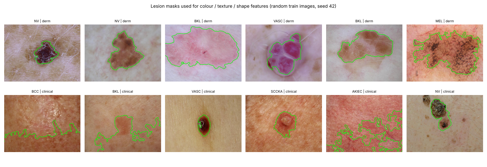
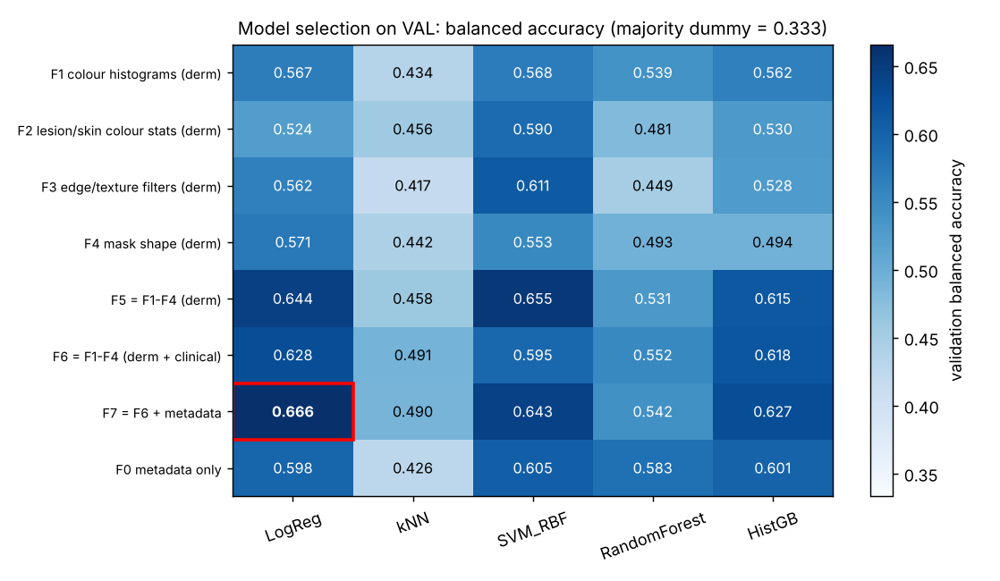
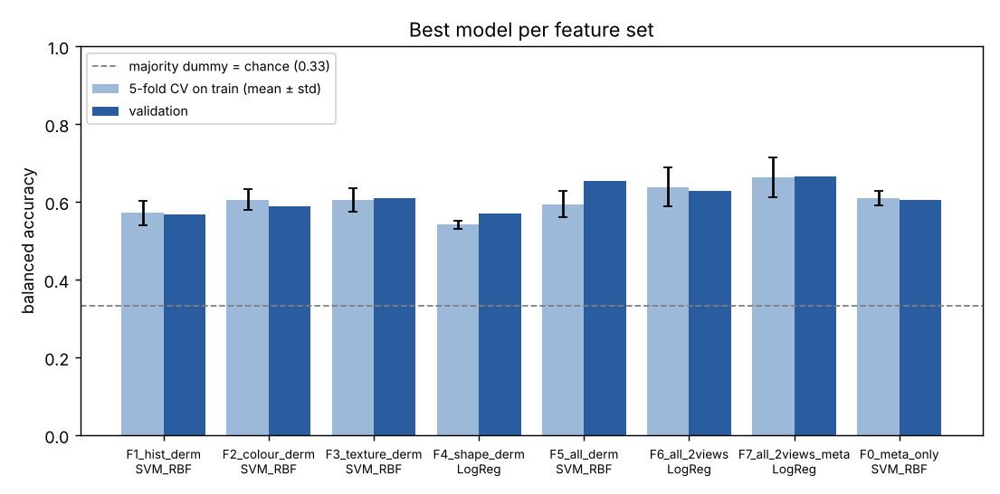
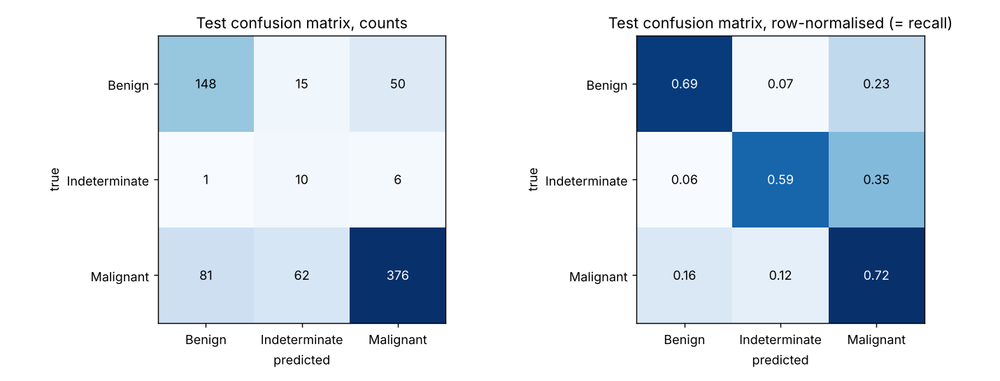
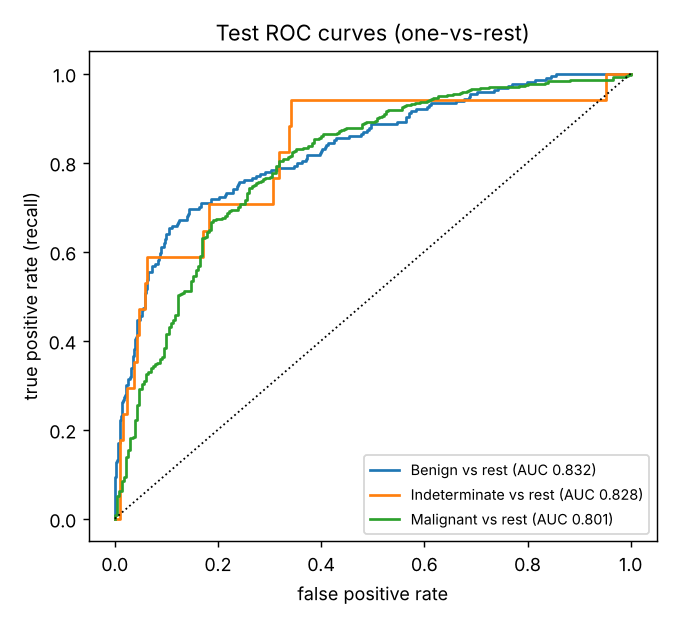
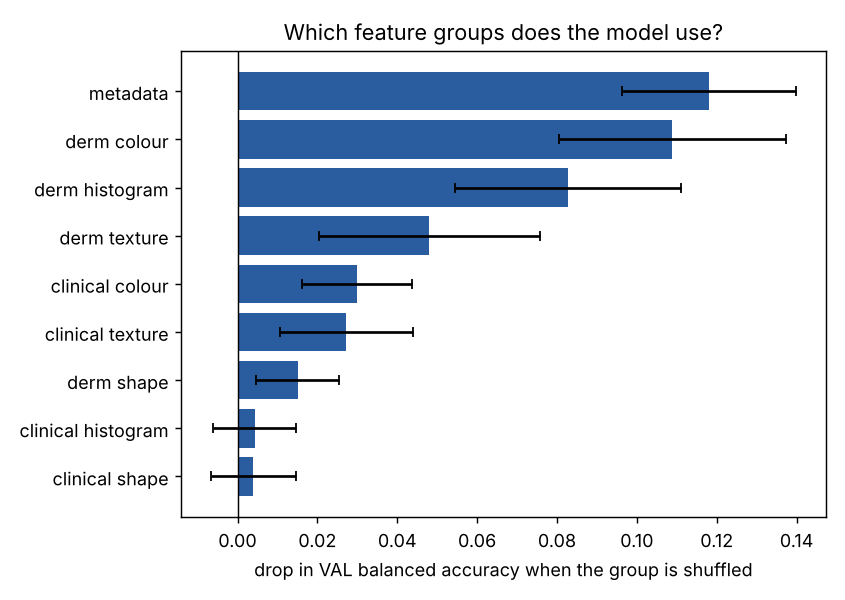
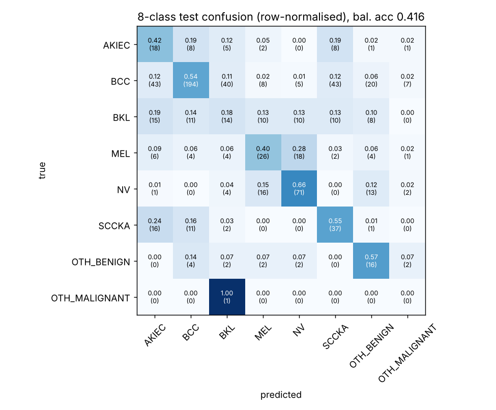

# Milestone 2: classical ML baseline for MILK10k skin-lesion classification

**Author:** Sebastián Ríos Saucedo · Computer Vision & Speech Recognition · EADA

**Code:** [`milk10k_pipeline/features.py`](../milk10k_pipeline/features.py) (features), [`milk10k_pipeline/classical.py`](../milk10k_pipeline/classical.py) (feature sets, models, metrics), [`scripts/09_extract_features.py`](../scripts/09_extract_features.py), [`scripts/10_model_selection.py`](../scripts/10_model_selection.py), [`scripts/11_final_evaluation.py`](../scripts/11_final_evaluation.py), [`scripts/12_fine_target.py`](../scripts/12_fine_target.py). Everything runs with `python scripts/run_milestone2.py`.

## 1. Summary

| | Value on the held-out TEST set (749 lesions), 95 % bootstrap CI |
|---|---|
| **Selected configuration** | **F7 = colour + texture + shape features of both views + metadata, Logistic Regression (L2, C = 0.01, class-balanced)** |
| Balanced accuracy (primary metric) | **0.669** [0.580, 0.744] (majority-class dummy: 0.333) |
| Macro-F1 | 0.550 [0.508, 0.594] (dummy: 0.273) |
| Malignant recall | 0.724 [0.686, 0.765] |
| "Needs work-up" sensitivity (Malignant or Indeterminate flagged as not benign) | 0.847 [0.817, 0.878], at a benign specificity of 0.695 |
| Macro one-vs-rest ROC-AUC | 0.820 [0.768, 0.859] |

The baseline is clearly better than chance, but it is **not** a usable triage tool: it calls **60 % of melanomas "Benign"**, and the single most useful feature group is **metadata (age)**, not the image. This is the bar the CNN in the next milestone has to beat.

## 2. Setup (what was kept from Milestone 1)

* **Task:** `diagnosis_1` with 3 classes, Benign / Indeterminate / Malignant (primary target fixed in Milestone 1). The 8-class `fine` target is a stretch (Section 7).
* **Data and splits:** the Milestone 1 lesion-level splits (`outputs/splits/*.csv`, StratifiedGroupKFold, seed 42), so no lesion is in two splits.

| split | lesions | Benign | Indeterminate | Malignant |
|---|---|---|---|---|
| train | 3,742 | 1,058 | 88 | 2,596 |
| val | 749 | 212 | 18 | 519 |
| test | 749 | 213 | 17 | 519 |

* **One sample = one lesion.** The features of the dermoscopic image (`d_` prefix) and of the clinical close-up (`c_` prefix) are concatenated (early fusion). Late fusion is compared in Section 6.4.
* **Leakage:** only image features and the three non-leaky metadata fields (age, sex, body site) are inputs. `diagnosis_confirm_type`, `diagnosis_2-4`, `melanocytic`, `concomitant_biopsy` and `image_manipulation` are never used (Milestone 1 data-quality report).
* **Imbalance:** Malignant : Indeterminate = 29.5 : 1 in train. Every model that supports it uses `class_weight="balanced"` (Session 3), and models are compared on **balanced accuracy** (mean per-class recall, the ISIC challenge metric), never on plain accuracy: the majority-class dummy already gets 69 % accuracy.

## 3. Hand-crafted features (concepts from Sessions 2-4)

All features are computed on the full 600 × 450 RGB image by [`features.py`](../milk10k_pipeline/features.py) (149 per image, about 0.13 s per image).

**Lesion mask.** Colour and texture are measured inside the lesion and compared with the skin around it, so each image first gets a rough lesion mask. In the Session 4 homework, Otsu on grayscale missed pale pink BCCs (they are barely darker than the skin in grayscale). The mask therefore uses a colour-aware score: Gaussian blur (σ = 4, removes hairs and dots) → per pixel "darker than the skin (CIELab L\*) + redder than the skin (a\*)", both as z-scores against a border band assumed to be skin → Otsu threshold → the connected region with the best area × centre-prior score → holes filled. Figure 1 shows that this works well on dermoscopic images and only roughly on clinical close-ups. The weak clinical masks are one reason the clinical features add little (Section 6.3).


*Figure 1. Lesion masks on random train images (top: dermoscopic, bottom: clinical).*

| Group | # per image | Features | Course concept |
|---|---|---|---|
| `hist` colour histograms | 80 | normalised R, G, B histograms (16 bins each) + H (16), S (8), V (8), whole image | Session 2 RGB channels, histograms; Session 3 HSV |
| `col` colour statistics | 39 | mean and std inside the lesion, mean of the skin, lesion − skin contrast, in RGB, HSV and CIELab; circular hue mean and spread; ΔE lesion vs skin; colour variegation (spread of Lab colours inside the lesion); fraction of red and of blue-grey lesion pixels | Sessions 2-3 colour spaces, normalisation, lesion hue/value |
| `tex` edge / texture filters | 21 | Sobel gradient magnitude (after σ = 2 Gaussian) inside the lesion, on a 7-px border ring and on the whole image; scale-normalised \|LoG\| at σ = 1, 2, 4 (dots / globules / blobs); 9 × 9 local standard deviation in the lesion and the skin; Canny edge density (my Session 4 thresholds 0.08 / 0.20 × max gradient); gray-level entropy | Session 4 convolution, Gaussian σ as scale, Sobel, LoG, local std, Canny |
| `shp` mask shape | 9 | area fraction, compactness (perimeter² / 4π·area), solidity, extent, eccentricity, asymmetry about the major and minor axes, centroid offset, fallback flag | Session 4 Otsu mask; dermatology ABCD rule (Asymmetry, Border, Diameter) |
| `meta` metadata (per lesion) | 8 | age, sex (one-hot), body site (one-hot + "missing", since 37 % of lesions have no site) | Session 2 metadata analysis |

## 4. Feature sets and models compared

**Feature sets** (to measure what each family of features is worth):

| Set | Content | # features |
|---|---|---|
| F1 | colour histograms, dermoscopic | 80 |
| F2 | lesion/skin colour statistics, dermoscopic | 39 |
| F3 | edge/texture filters, dermoscopic | 21 |
| F4 | mask shape, dermoscopic | 9 |
| F5 | F1-F4, dermoscopic only | 149 |
| F6 | F1-F4 for both views | 298 |
| F7 | F6 + metadata | 306 |
| F0 | metadata only (reference: how much does the image add?) | 8 |

**Models.** Each one is a scikit-learn `Pipeline`: median imputation → `StandardScaler` → classifier. Imputer and scaler are fitted inside each CV fold, so validation folds never leak into the scaling statistics.

| Model | Hyper-parameter grid | Imbalance handling |
|---|---|---|
| Logistic Regression (multinomial, L2) | C ∈ {0.01, 0.1, 1, 10} | class_weight = balanced |
| k-Nearest Neighbours (distance-weighted) | k ∈ {5, 15, 31} | none available |
| SVM, RBF kernel | C ∈ {0.3, 1, 3, 10}, γ = "scale" | class_weight = balanced |
| Random Forest (300 trees) | max_depth ∈ {None, 12}, min_samples_leaf ∈ {1, 5} | balanced_subsample |
| Histogram Gradient Boosting (200 iter.) | learning_rate ∈ {0.05, 0.1}, max_depth ∈ {3, None} | class_weight = balanced |
| Dummy: majority class / stratified random | none | reference only |

## 5. Evaluation protocol

1. **Hyper-parameters:** 5-fold stratified CV on TRAIN (one row per lesion, so folds cannot share a lesion). Scoring = balanced accuracy.
2. **Choice of configuration:** each tuned model is refitted on all of TRAIN and scored on VAL. The (feature set, model) pair with the highest VAL balanced accuracy wins (ties → macro-F1). 8 × 5 = 40 candidates.
3. **Final estimate:** the winner is refitted on TRAIN + VAL with the same hyper-parameters and scored **once** on TEST. TEST was not used for any decision. 95 % confidence intervals come from 1,000 bootstrap resamples of the test lesions.
4. **Metrics:** balanced accuracy (selection), macro-F1, per-class precision / recall / F1, confusion matrix, one-vs-rest ROC-AUC, plus a triage view: **work-up sensitivity** (Indeterminate + Malignant flagged as "not benign") and benign specificity.

## 6. Results

### 6.1 Model selection (validation)


*Figure 2. Validation balanced accuracy of every (feature set, model) pair. Red box = selected.*


*Figure 3. Best model per feature set: 5-fold CV on train (mean ± std) and validation.*

Full table: [`outputs/classical/model_selection.csv`](../outputs/classical/model_selection.csv). Main observations:

* **Every single feature family beats chance** (0.55-0.61 vs 0.33). Texture (F3, SVM 0.611) and colour statistics (F2, SVM 0.590) are the strongest single families, and shape alone is the weakest (F4, ≤ 0.571).
* **Combining families helps:** F5 (all dermoscopic) 0.644-0.655 vs ≤ 0.611 for any single family.
* **The clinical view adds almost nothing on its own:** F6 (both views) 0.628 vs F5 0.644 for LogReg. It doubles the features but its masks and colours are much noisier (Figure 1).
* **Metadata is strong, and it is a warning sign.** Age, sex and body site alone (F0) reach about 0.60 (val 0.58-0.61, CV up to 0.62), as good as any single image family. Images + metadata (F7) give the best result: **LogReg 0.666** (CV 0.663 ± 0.052), so the images add about +0.06 over metadata alone.
* **Models:** linear models and the RBF SVM are best. After scaling, these features are fairly linearly separable and the data are small, so strong L2 regularisation (C = 0.01) wins. Random Forest and kNN reach a fair macro-F1 (up to 0.60) but **the lowest balanced accuracy**: they predict "Malignant" for most lesions and almost never "Indeterminate" (val Indeterminate recall 0-0.22). Even with balanced weights, trees and kNN do not cope with an 88-lesion class. HistGB is in between (val 0.627, best macro-F1 0.625).
* **Uncertainty:** CV standard deviations are 0.02-0.07, and the top four configurations (0.643-0.666) are within one standard deviation of each other. The validation set has only **18 Indeterminate lesions**, and one of them moves balanced accuracy by about 1.9 points. The choice of LogReg on F7 is reasonable, but it is not clearly better than SVM on F5/F7.

### 6.2 Final model on the test set

| Metric | Selected (F7 + LogReg) | Dummy majority | Dummy stratified |
|---|---|---|---|
| Balanced accuracy | **0.669** [0.580, 0.744] | 0.333 | 0.343 |
| Macro-F1 | **0.550** [0.508, 0.594] | 0.273 | 0.344 |
| Accuracy | 0.713 | 0.693 | 0.553 |
| Recall Benign / Indeterminate / Malignant | 0.695 / 0.588 / 0.724 | 0 / 0 / 1 | 0.30 / 0.06 / 0.67 |
| Precision Benign / Indeterminate / Malignant | 0.644 / 0.115 / 0.870 | – | – |
| Macro ROC-AUC (OvR) | 0.820 [0.768, 0.859] | 0.500 | 0.503 |
| AUC Malignant vs rest / Benign vs rest | 0.801 / 0.832 | 0.5 / 0.5 | – |
| Work-up sensitivity / benign specificity | 0.847 / 0.695 | 1.000 / 0.000 | 0.696 / 0.296 |

Test balanced accuracy (0.669) matches validation (0.666) and CV (0.663), so there is **no sign of overfitting to the validation set** despite the 40-way selection.


*Figure 4. Test confusion matrix (left: counts, right: row-normalised = recall).*


*Figure 5. One-vs-rest ROC curves on test.*

* **Indeterminate** reaches 0.59 recall, but with 0.115 precision: 77 of the 87 lesions predicted "Indeterminate" are really Malignant (62) or Benign (15). This is the price of balanced class weights on a 17-lesion class, and the reason macro-F1 (0.55) is much lower than balanced accuracy.
* **81 malignant lesions (16 %) are called Benign.** For triage this is the most expensive error.

### 6.3 What the model uses: grouped permutation importance (validation)


*Figure 6. Drop in validation balanced accuracy when all columns of a group are shuffled together (10 repeats; correlated columns are shuffled as a block so they cannot hide each other).*

Metadata is the most important group (−0.118), followed by dermoscopic colour (−0.109), dermoscopic histograms (−0.083) and dermoscopic texture (−0.048). The clinical image contributes only through colour and texture (−0.03 each), and clinical histograms and shape are useless (≈ 0). The model therefore relies on dermoscopic colour, which is consistent with the Session 4 finding that grayscale edges alone do not separate benign from malignant. It also leans heavily on **age**.

### 6.4 Design check: early vs late fusion of the two views (validation)

| Design | Bal. acc | Macro-F1 | Malignant recall |
|---|---|---|---|
| Early fusion: d_ + c_ features concatenated (selected) | **0.666** | **0.545** | **0.726** |
| Late fusion: one model for both views, probabilities averaged per lesion (Milestone 1 option (a)) | 0.627 | 0.498 | 0.634 |

Early fusion is better: it can weight the dermoscopic view more than the clinical one, while late fusion averages a good and a poor prediction with equal weight.

### 6.5 Error analysis on test

Per fine diagnosis ([`test_by_dx.csv`](../outputs/classical/test_by_dx.csv)):

| dx (n) | Correct | Predicted Benign / Indeterminate / Malignant |
|---|---|---|
| BCC (360) | 0.80 | 0.10 / 0.10 / 0.80 |
| NV (107) | 0.96 | 0.96 / 0.01 / 0.03 |
| BKL (78) | 0.40 | 0.40 / 0.15 / 0.45 |
| SCCKA (67) | 0.78 | 0.04 / 0.18 / 0.78 |
| **MEL (65)** | **0.28** | **0.60** / 0.12 / 0.28 |
| AKIEC (43, Indet. or Malignant) | 0.65 | 0.07 / 0.37 / 0.56 |
| DF / VASC / INF / BEN_OTH (28) | 0.50 | mixed |

* **Melanoma is the main failure: 60 % of melanomas are called Benign.** Melanomas look like nevi (pigmented, brown, structured), and nevi are recognised almost perfectly (96 %). Global colour and texture statistics cannot capture the *local* patterns that separate them (atypical network, regression, irregular dots), so the model learns "brown pigmented lesion → benign".
* **Seborrheic keratoses (BKL) are called Malignant 45 % of the time.** They are the "busy texture" benign lesions from the Session 4 homework.

Subgroups ([`test_subgroups.csv`](../outputs/classical/test_subgroups.csv)):

| Group | n | Bal. acc | Malignant recall | Benign recall | % malignant |
|---|---|---|---|---|---|
| female | 281 | 0.664 | 0.665 | 0.755 | 62.6 |
| male | 468 | 0.666 | 0.755 | 0.643 | 73.3 |
| age < 50 | 124 | 0.674 | **0.426** | 0.922 | 37.9 |
| age 50-69 | 335 | 0.678 | 0.730 | 0.636 | 71.9 |
| age ≥ 70 | 288 | 0.579 | 0.779 | **0.413** | 80.2 |

Balanced accuracy is similar for women and men, but the **age shortcut is visible**: under 50, more than half of the malignant lesions are missed, and over 70, most benign lesions are flagged. The model partly predicts "older → malignant". That is true on average in MILK10k (median age: Benign 55, Malignant 65), but it is not a property of the lesion. Skin tone is not available in the metadata, so fairness across skin tone cannot be checked.

## 7. Stretch: 8-class fine target

Same configuration (F7 + LogReg, C re-tuned by CV → 0.01), test set: **balanced accuracy 0.416** [0.377, 0.506], macro-F1 0.370, macro AUC 0.862 (chance balanced accuracy = 0.125). NV (recall 0.66), SCCKA (0.55), BCC (0.54) and OTHER_BENIGN (0.57) are recognised. BKL (0.18) and OTHER_MALIGNANT (0 of 1) are not, and MEL reaches 0.40 recall. Melanomas are still confused with nevi (18 of 65), and many BCCs are spread over AKIEC and SCCKA (Figure 7). Files: [`fine_metrics.csv`](../outputs/classical/fine_metrics.csv), [`fine_test_confusion.csv`](../outputs/classical/fine_test_confusion.csv).


*Figure 7. 8-class test confusion matrix (row-normalised, counts in brackets).*

## 8. Conclusions and what the CNN must beat

* **Best classical configuration:** colour + texture + shape features of both views + metadata, class-balanced Logistic Regression (C = 0.01). Test balanced accuracy **0.669** [0.58, 0.74], macro-F1 0.550, macro AUC 0.820, malignant recall 0.724.
* Colour is the most informative image cue, then texture, and shape is the weakest. The dermoscopic view carries almost all of the image signal.
* Metadata alone gets ~0.60. The images add only ~+0.06 on top, and the model learns an age shortcut. Future models should always be reported **with and without metadata**.
* Limitations: rough masks on clinical images, hair not removed (Session 4: hair dominates the edge filters), global statistics only (no local pattern descriptors), and a tiny Indeterminate class that makes every balanced metric noisy (CI width ±0.08).
* **Next milestone:** a CNN on the same splits and the same metrics. It must beat **0.669 balanced accuracy / 0.820 macro AUC** and above all fix melanoma recall (0.28 here) without relying on age.

## 9. Reproducibility

```bash
# data folder next to the repo, or set MILK10K_DATA_DIR (see README)
python scripts/run_milestone2.py            # 09 -> 12, about 1 h on 2 CPU cores
# or step by step
python scripts/09_extract_features.py --workers 4   # ~10 min, writes outputs/features/*.csv.gz
python scripts/10_model_selection.py                # ~45 min (40 candidates x 5-fold CV)
python scripts/11_final_evaluation.py               # test metrics, figures, importance, subgroups
python scripts/12_fine_target.py                    # 8-class stretch
```

Seed 42 everywhere. The extracted features are committed (`outputs/features/`, 4.7 MB each), so steps 10-12 run **without the images**. Run with scikit-learn 1.9 / OpenCV 5.0. On an older scikit-learn the numbers can differ slightly.
